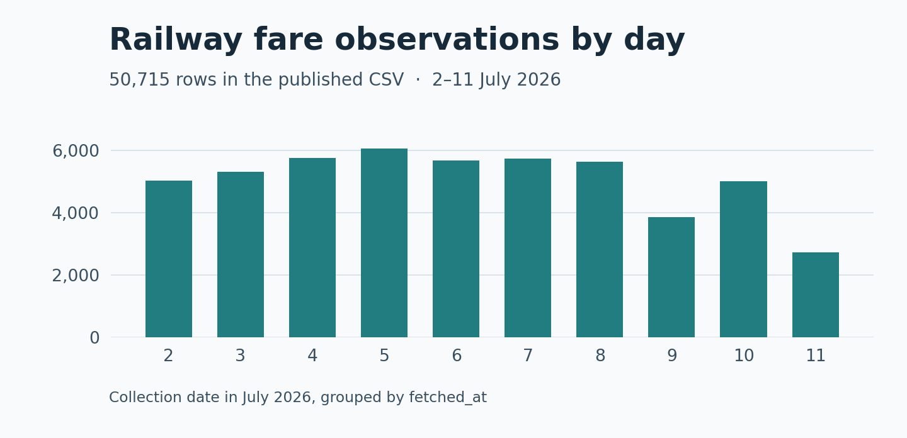

# Railway fare collector

A Python script that collects fare and seat availability data from Russian Railways (RZD) and stores it in PostgreSQL. I built it to track fares on five routes out of Moscow at several booking horizons.

## Published data

The [CSV export](rzd_prices_export.csv) contains **50,715 rows** dated **2–11 July 2026**, grouped under 38 distinct collection timestamps. Each row records a train and carriage option, its fare, and the reported number of free seats. These are observations collected at different times, so the same train may appear more than once. An [Excel export](rzd_prices.xlsx) is also available.



## Run one collection pass

From the repository root, install the dependencies in a Python environment with `python -m pip install -r requirements.txt`.

Create a PostgreSQL database and configure the connection in a local `.env` file. The database role needs permission to create the table and insert rows.

```dotenv
PGHOST=localhost
PGPORT=5432
PGDATABASE=rzd_prices
PGUSER=postgres
PGPASSWORD=
```

Run `python main.py`. The script creates the `rzd_prices` table if needed and writes one batch. Routes and booking horizons are set in `main.py`. When a request fails or yields no rows, the script saves the response or error details under `rzd_prices_raw/`.

For recurring runs, schedule the command externally. Live collection depends on the current RZD endpoints. The exports can be explored without contacting RZD.
