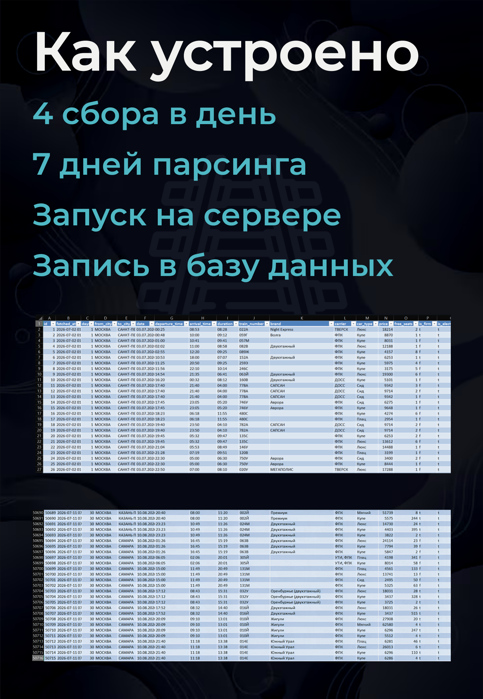

# Russian Railways data parser with long-term information collection

Developed a Python script for automatically collecting data on rail transportation along several routes. The script was deployed on the server and worked autonomously for 7 days in a row, collecting data 4 times a day (morning, afternoon, evening, night) - the final dataset amounted to more than 50,000 records.

The collected data includes the route, date and time, cost and class of seats, availability and other parameters - such an array can be used to analyze price dynamics, identify seasonal fluctuations in demand and compare destinations.

